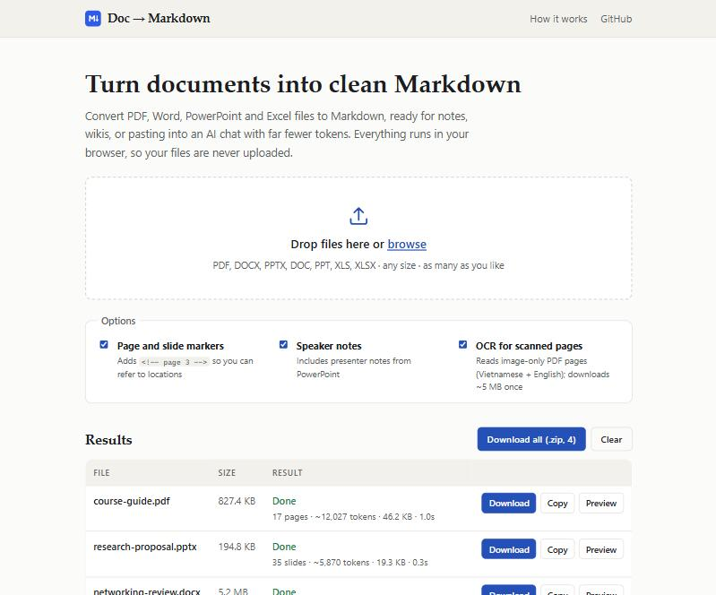

# Doc → Markdown

**Turn PDF, Word, PowerPoint and Excel files into clean Markdown, right in your browser.**

**[Open the app → doc-to-md-three.vercel.app](https://doc-to-md-three.vercel.app)**



Markdown is the cheapest way to hand a long document to an AI assistant. A 107-page lecture deck becomes about 24,000 tokens of plain text instead of an expensive PDF, with the headings, lists and tables still intact. The output also works well in notes apps, wikis and documentation sites.

## Highlights

- **Private by design.** Conversion runs entirely in your browser, so nothing is uploaded and there is no file-size limit.
- **Seven formats.** PDF, DOCX, PPTX, plus legacy DOC, PPT, XLS and XLSX.
- **Structure, not just text.** Headings, bullet levels, tables, slide titles, charts and speaker notes come through as proper Markdown.
- **Less noise.** Repeated headers and footers, page numbers and empty spreadsheet cells are stripped.
- **Scanned PDFs too.** Image-only pages are read with OCR (Vietnamese and English).
- **Batch friendly.** Drop many files at once, then download them one by one or as a single .zip.

## How it works

1. **Drop your files** onto the page, or click to browse.
2. **They are converted on your device**, using the libraries listed below compiled for the browser.
3. **Download the Markdown**, copy it, or preview it in place.

## What you get, by format

| Format | What is kept |
| --- | --- |
| **PDF** | Headings detected from font size and bold text; paragraphs and bullet lists; tables with ruled borders or shaded cells rebuilt as Markdown tables; spaced-out titles such as “C H A P T E R” rejoined (Vietnamese and English); OCR for scanned pages. Headers, footers and page numbers are removed. |
| **Word** `.docx` `.doc` | Headings, lists, bold and italic text, tables. |
| **PowerPoint** `.pptx` `.ppt` | Slide titles, bullets with indentation, tables, charts as data tables, SmartArt text, image alt text, speaker notes. Shapes are read top to bottom, left to right. |
| **Excel** `.xlsx` `.xls` | One table per sheet, with empty rows and columns removed. |

Optional `<!-- page 12 -->` / `<!-- slide 4 -->` markers make it easy to point back to a location in the original.

## Command line

The same converters run in Node.js, which is handy for scripts and AI agents that should read Markdown instead of the original file.

```bash
git clone https://github.com/loocnguyn/doc-to-md.git
cd doc-to-md
npm install
npm run md -- lecture.pdf              # writes lecture.md next to it
npm run md -- slides/*.pptx -o md/     # many files into one folder
npm run md -- syllabus.docx --stdout   # print instead of writing a file
```

Options: `--no-pages`, `--no-notes`, `--no-ocr`. Run `npm run md -- --help` for details.

## Limitations

- PDF tables without any borders or cell shading (columns aligned only by spacing) come out as lines of text.
- OCR quality depends on the scan. Expect occasional wrong diacritics on low-resolution pages.
- Images are not carried over (only their alt text in PowerPoint).
- Spaced-out titles that are ambiguous without a dictionary (for example “THỰCHÀNH”) may be split slightly wrong.

## Built with

- [pdf.js](https://github.com/mozilla/pdf.js) for reading PDFs, and [Tesseract.js](https://github.com/naptha/tesseract.js) for OCR
- [Mammoth](https://github.com/mwilliamson/mammoth.js) and [Turndown](https://github.com/mixmark-io/turndown) for Word documents
- [JSZip](https://github.com/Stuk/jszip) for PowerPoint files
- [office_oxide](https://github.com/yfedoseev/office_oxide) (WebAssembly) for DOC, PPT, XLS and XLSX

Ideas borrowed from [opengovsg/pdf2md](https://github.com/opengovsg/pdf2md) (bold-font detection, header/footer removal), [pdfplumber](https://github.com/jsvine/pdfplumber) and [firecrawl/pdf-inspector](https://github.com/firecrawl/pdf-inspector) (finding tables from ruling lines and shaded cells), [microsoft/markitdown](https://github.com/microsoft/markitdown) (PowerPoint reading order, charts as tables) and [keredson/wordninja](https://github.com/keredson/wordninja) (splitting run-together words by word frequency).

## Development

```bash
npm install
npm run dev     # http://localhost:5173
npm test        # unit tests
npm run build   # static site in dist/
```

The site is a static Vite build deployed on Vercel. Every push to `main` deploys automatically.
